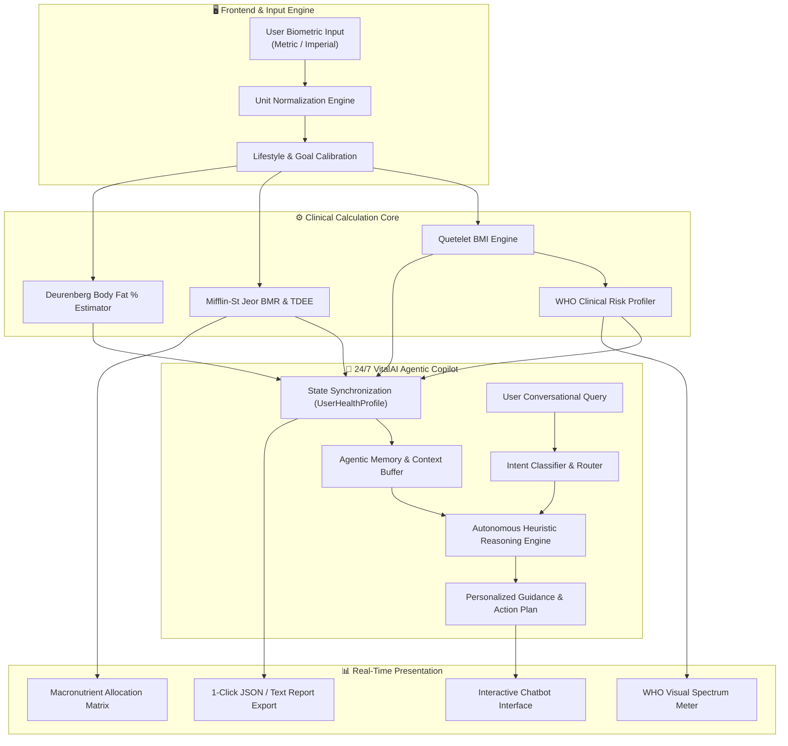

<div align="center">

# 🧬 VitalAI — Autonomous Health & BMI Intelligence Platform
### *Production-Grade Agentic Health Copilot & Biometric Analytics System*

[](https://agentic-bmi-health-assistant.streamlit.app/)
[](https://python.org)
[](https://agentic-bmi-health-assistant.streamlit.app/)
[](#-agentic-ai-architecture)
[](https://agentic-bmi-health-assistant.streamlit.app/)
[](LICENSE)

<br/>

[](https://agentic-bmi-health-assistant.streamlit.app/)

<br/>

> **VitalAI** transforms conventional, static BMI calculators into an **intelligent, autonomous health decision support system**. Engineered by an **Agentic AI Developer**, it combines precision anthropometrics, metabolic forecasting, and a **24/7 context-aware conversational health agent**.

### 🌐 [**🚀 Click Here to Open the Live Streamlit App**](https://agentic-bmi-health-assistant.streamlit.app/)

[Live Demo](https://agentic-bmi-health-assistant.streamlit.app/) • [Explore Features](#-key-features) • [System Architecture](#-agentic-ai-architecture) • [Quickstart](#-quickstart--installation) • [Clinical Formulas](#-clinical-specifications)

---

</div>

## 🌐 Live Cloud Deployment

Experience the production deployment running live 24/7 on Streamlit Community Cloud:

👉 **[https://agentic-bmi-health-assistant.streamlit.app/](https://agentic-bmi-health-assistant.streamlit.app/)**

- **Zero Setup Required**: Instant in-browser experience on mobile, tablet, and desktop.
- **Synced Biometrics**: Calculate live BMI, BMR, TDEE, and chat with the 24/7 autonomous copilot immediately.

---

## 🌟 Highlights & Why This Project Stands Out

Most beginner BMI projects are 20-line scripts that only calculate `weight / height²`.  
**VitalAI was engineered as an enterprise-grade showcase** representing how modern AI agents seamlessly augment human health tracking:

- 🧠 **Context-Aware 24/7 AI Health Agent**: Embedded autonomous copilot that holds memory of user biometrics, answers nutrition questions, provides custom 7-day meal plans, and suggests tailored workout regimens.
- ⚡ **Zero-Latency Offline Resilience**: Works 100% offline out-of-the-box without requiring paid API tokens, while maintaining optional drop-in support for Gemini/OpenAI models.
- 📐 **Comprehensive Clinical Engine**: Delivers Quetelet BMI, WHO Comorbidity Risk, Ideal Weight Bounds, Mifflin-St Jeor BMR, Activity-Adjusted TDEE, Deurenberg Body Fat %, and Daily Hydration protocols.
- 🎨 **Next-Gen Cybernetic Glassmorphic UI**: High-contrast, responsive dark UI with dynamic visual spectrum meters, real-time reactive feedback, and interactive metric cards.
- 📥 **Exportable Health Dossiers**: Generates 1-click structured clinical JSON summaries and text reports for medical consultations.

---

## 🏛️ Agentic AI Architecture



---

## 🚀 Key Features

| Feature | Description |
| :--- | :--- |
| **🤖 24/7 Live AI Health Copilot** | Autonomous agent that monitors your profile and generates personalized dietary blueprints, hypertrophy/fat loss workout splits, and weight roadmaps. |
| **📏 Dual Measurement Engine** | Seamless toggle between **Metric** (kg, cm) and **Imperial** (lbs, ft & in) with sub-millimeter precision normalization. |
| **📊 WHO Dynamic Visual Meter** | Interactive visual spectrum indicator plotting the user's position along WHO benchmark categories from Underweight to Obese Class III. |
| **🔥 Metabolic Forecasting (BMR & TDEE)** | Calculates exact basal caloric expenditure and activity-adjusted daily maintenance vs. deficit/surplus caloric targets. |
| **🥩 Macronutrient Matrix** | Real-time calculation of optimal protein, complex carbohydrate, and healthy fat splits tailored to user body weight and objectives. |
| **💧 Hydration Protocol Engine** | Personalized daily water intake calculations factoring body mass and physical exercise intensity. |
| **📄 Clinical Export Engine** | Downloadable timestamped JSON dossiers and structured text summaries for physician records. |

---

## 💻 Tech Stack

- **Framework**: [Streamlit](https://streamlit.io/) (Reactive Python Web Architecture)
- **Language**: [Python 3.12+](https://python.org)
- **Data & Analytics**: [Pandas](https://pandas.pydata.org/), NumPy
- **Styling**: Cybernetic Glassmorphic CSS3 with custom keyframe pulse animations
- **Architecture**: Modular Agentic AI Pattern with Clean State Synchronization

---

## ⚡ Quickstart & Installation

### Option 1: Standard Python (`pip`)

1. **Clone the repository:**
   ```bash
   git clone https://github.com/SainBux-HadiSeelro/agentic-bmi-health-assistant.git
   cd agentic-bmi-health-assistant
   ```

2. **Create and activate a virtual environment (optional but recommended):**
   ```bash
   python -m venv .venv
   # Windows:
   .venv\Scripts\activate
   # macOS/Linux:
   source .venv/bin/activate
   ```

3. **Install dependencies:**
   ```bash
   pip install -r requirements.txt
   ```

4. **Launch the platform:**
   ```bash
   streamlit run app.py
   ```

---

### Option 2: Lightning Fast with `uv`

```bash
uv pip install -r requirements.txt
uv run streamlit run app.py
```

The application will launch automatically at `http://localhost:8501`.

---

## 📂 Project Structure

```plaintext
vitalai-health-platform/
│
├── app.py               # Main Streamlit web application & glassmorphic UI
├── agent.py             # 24/7 Context-aware Agentic AI engine & memory state
├── SPECIFICATIONS.md    # Comprehensive technical, architectural & clinical specs
├── README.md            # Modern portfolio documentation
├── requirements.txt     # Python project dependencies
├── pyproject.toml       # Python packaging configuration
└── .gitignore           # Git ignore configuration
```

---

## 🔬 Clinical Specifications & Validations

- **Quetelet Formula**: $\text{BMI} = \frac{\text{Weight (kg)}}{(\text{Height (m)})^2}$
- **Mifflin-St Jeor (BMR)**:
  - *Male*: $10 \times \text{kg} + 6.25 \times \text{cm} - 5 \times \text{age} + 5$
  - *Female*: $10 \times \text{kg} + 6.25 \times \text{cm} - 5 \times \text{age} - 161$
- **Deurenberg Body Fat Estimation**:
  $$\text{Body Fat } \% = (1.20 \times \text{BMI}) + (0.23 \times \text{Age}) - (10.8 \times \text{Sex}) - 5.4$$

*For full algorithmic definitions, see [SPECIFICATIONS.md](SPECIFICATIONS.md).*

---

## 👨‍💻 Author & Portfolio Showcase

Engineered with precision by an **Agentic AI Developer**.  
Specialized in building autonomous multi-agent workflows, production-ready AI applications, and resilient data-driven software.

- 💼 **Portfolio**: [Your Portfolio Link](#)
- 🐙 **GitHub**: [@SainBux-HadiSeelro](https://github.com/SainBux-HadiSeelro)
- 🔗 **LinkedIn**: [Connect on LinkedIn](https://linkedin.com)

---

<div align="center">
  <sub>Built with ❤️, Python, and Agentic Intelligence. If you found this useful, feel free to star ⭐ the repository!</sub>
</div>
